# 课堂专注度分析系统设计说明书

## 1 简介

### 1.1 作品创意/项目背景

在课堂教学活动中，教师往往需要在有限的教学时间内兼顾授课进程、课堂秩序与学生反馈，因此很难持续、客观地观察每一位学生的听课状态。传统依赖人工巡视或课后回看视频的方式，虽然具有直观性，但受观察范围、主观经验和时间成本的限制，难以形成稳定、连续且可量化的分析结果。随着计算机视觉技术与多模态大模型技术的不断发展，利用智能分析手段对课堂视频进行自动处理，并在此基础上识别学生专注状态、挖掘课堂互动行为、生成结构化统计与文本化结论，已经成为教育智能化场景中的一个重要研究方向。基于这一背景，本项目设计并实现了一套面向课堂视频场景的专注度分析系统，旨在利用姿态估计、多目标跟踪、规则判定和大模型报告生成等技术，对课堂中学生的专注状态与互动表现进行自动分析。

本系统以教室视频作为输入对象，以学生个体的姿态变化、动作持续时长和互动行为作为分析依据，通过人体检测、姿态关键点识别、多目标跟踪、规则评分和时序状态建模等方法，对课堂中学生的专注状态进行自动识别，并将分析结果输出为结构化数据、可视化标注视频以及自然语言分析报告。与一般性的人体检测或动作识别项目相比，本系统更加关注课堂教学这一具体应用语境，强调对“低头”“侧倾”“长时间静止”“持续举手”等课堂行为的解释能力和综合表达能力，力图形成从视频理解到结果表达的完整技术链路。

从应用目标来看，本项目既可以作为课堂教学辅助分析工具，为课后复盘、课堂观察和行为统计提供量化依据，也可以作为计算机视觉与人工智能融合应用的课程实践成果，体现模型调用、规则设计、系统开发和结果生成的综合能力。系统当前已经具备较为完整的离线分析流程，能够支持项目展示、功能验证与后续拓展。

### 1.2 项目实施计划

本项目由小组协作完成，整体实施过程遵循“前期验证、核心重构、规则完善、报告增强、界面集成”的推进思路。项目初期，团队首先围绕课堂视频中学生行为识别的可行性展开探索，尝试采用 `YOLO + DeepSORT + MediaPipe` 的技术路线，并以旧版脚本 `ca.py` 作为实验性实现载体。该阶段的主要目标在于验证课堂场景下学生检测、身份关联和姿态分析的基本可用性。实践结果表明，这一路线虽然能够完成初步的目标检测和行为识别，但在复杂教室环境中仍存在目标关联稳定性不足、姿态处理链路较长以及工程结构不易维护等问题。

在完成前期验证之后，项目进入主流程重构阶段。团队将核心检测链路迁移至模块化实现方案，采用 `YOLOv8m-pose` 直接输出人体检测框与关键点信息，并结合 `ByteTrack` 完成多目标跟踪。这一调整使系统的视觉感知链路更加统一，也显著提高了课堂场景下学生跨帧身份关联的稳定性。随后，项目围绕课堂专注度分析这一核心问题，逐步建立了一套规则化行为判定框架，将低头、侧倾、手部位置异常等短时姿态变化，与长时间低头、闭眼、静止和举手等时序行为统一纳入分析体系。通过这一过程，系统由单纯依赖模型推理的实验原型，逐渐演进为兼具分析、统计与解释能力的课堂行为分析系统。

在后续完善阶段，项目进一步增加了结构化摘要导出、关键帧提取和多模态大模型报告生成功能，使系统不仅能够输出检测结果，而且能够基于检测结果形成较为完整的课堂分析文本。同时，为降低系统使用门槛、增强成果展示效果，团队又实现了本地 Web 工作台，使用户能够通过浏览器完成视频上传、参数配置、任务提交、日志查看与结果下载等操作。总体而言，本项目的实施过程体现出较清晰的阶段性演进特征，即先验证技术路线，再重构主链路，继而扩展分析能力和交互形式，这也构成了本设计说明书展开论述的基本逻辑。

## 2 总体设计

### 2.1 系统功能

#### 2.1.1 功能概述

本系统是一套面向课堂视频的离线智能分析系统，其核心目标在于识别学生在课堂中的专注行为与互动表现，并形成可回溯、可统计、可阅读的综合分析结果。系统以本地视频文件作为输入，通过姿态估计模型、多目标跟踪算法和规则驱动的行为分析逻辑，对视频进行逐帧处理，在完成学生目标检测与身份跟踪之后，进一步对个体姿态及其时序变化进行分析，最终输出检测记录、聚合摘要、标注视频以及文字报告。

从整体流程来看，系统首先读取课堂视频，并逐帧送入姿态检测模型，对画面中的学生进行人体检测和关键点定位；随后利用多目标跟踪算法建立同一学生在连续帧中的身份关联；在此基础上，系统结合单帧姿态几何关系与多帧时间累积状态，对学生的低头、倾斜、静止、举手等行为进行判定，并将疑似不专注的记录持续保存；在处理结束后，系统进一步对离散记录进行时间段聚合，形成结构化摘要；最后，若启用报告功能，则系统会根据关键事件提取代表性帧图像，并借助多模态大模型生成课堂分析报告。由此，系统形成了“视频输入—视觉检测—行为分析—结果汇总—报告输出”的完整工作流。

该系统具有较强的场景针对性和工程完整性。一方面，它能够直接面向真实课堂视频开展多目标分析，支持对多名学生进行统一识别和持续跟踪；另一方面，它并非仅停留在模型推理层面，而是进一步完成了数据组织、事件聚合和文本生成，从而提升了分析结果的可解释性与展示价值。
图 2-1 从总体功能角度展示了系统的功能框架。系统以课堂视频作为输入，围绕视频分析、行为识别、结果输出和智能报告生成四个核心环节展开，最终形成面向教学复盘和课堂行为分析的综合结果。

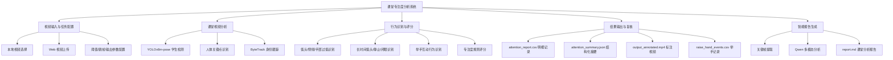

图 2-1 系统功能框架图

#### 2.1.2 功能说明

从使用者视角来看，系统主要提供视频分析、结果导出和报告生成三类能力。首先，用户可以通过命令行或 Web 页面选择待分析的课堂视频，并根据实际场景调整阈值、跳帧数、输出路径和报告选项等参数。系统启动后，会自动完成课堂中学生个体的检测与跟踪，并对其姿态变化进行实时分析。对于被判断为不专注的行为片段，系统将逐条记录其发生时间、帧号、得分、边界框和触发原因，并在最终输出中形成专门的明细文件。


在专注度分析之外，系统还能够识别课堂中的持续举手行为，从而补充对课堂互动状态的观察。为了便于人工复核，系统支持生成带有边界框和状态标签的标注视频，使用户能够直观查看各时间段的识别效果。进一步地，系统还能在检测完成后输出结构化 JSON 摘要，对重点学生、事件持续时间、主要原因和关键帧候选进行统一整理。在此基础上，若用户启用了智能报告功能，系统将根据摘要信息提取关键帧，并结合文字模板和多模态大模型生成自然语言报告，使分析结果更加适合课程设计说明、项目展示和教学复盘等场景。

从系统内部处理过程来看，视频分析并不是单一的模型推理过程，而是由检测、跟踪、过滤、评分和聚合等多个环节共同构成。图 2-2 展示了系统从课堂视频输入到行为事件生成的主要流程。该流程体现了系统对“单帧姿态信息”和“跨帧时间状态”的综合利用，也说明了系统为什么能够对持续低头、静止和举手等行为进行判断。

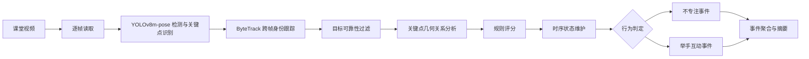

图 2-2 视频分析与行为识别流程图

系统输出结果之间具有较强的层次关系。`attention_report.csv` 保存逐条检测记录，属于最基础的明细数据；`attention_summary.json` 在明细数据基础上进行聚合，形成面向学生和事件的结构化摘要；`output_annotated.mp4` 和 `report_keyframes` 提供可视化复核依据；最终的 `report.md` 则在结构化摘要和关键帧基础上生成，面向阅读和汇报场景。图 2-3 展示了系统主要输出文件之间的关系。

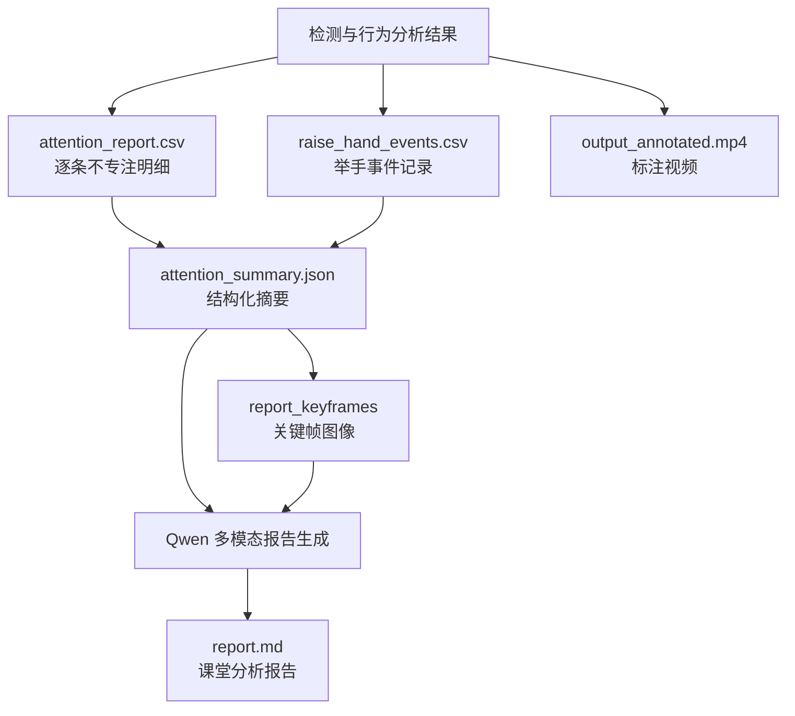

图 2-3 系统输出结果关系图

### 2.2 系统软硬件平台

#### 2.2.1 系统开发平台（含开源/第三方工具）

本项目采用 Python 作为主要开发语言，整体开发环境建立在深度学习推理框架、计算机视觉处理库以及通用数据分析工具的基础之上。系统推荐使用 Python 3.9 及以上版本，以保证对依赖库的兼容性和运行稳定性。结合项目当前源码和运行方式来看，系统主要在 Windows 环境下开发与调试，但在设计时兼顾了 Linux 与 macOS 的可迁移性，因此具有一定的跨平台能力。

在模型推理层面，项目以 PyTorch 作为底层深度学习框架，负责模型加载、张量运算与 GPU 加速支持；以 Ultralytics 提供的 YOLO 框架作为核心视觉能力基础，用于调用姿态估计模型并执行检测与跟踪流程；以 OpenCV 负责视频读取、逐帧处理、边界框绘制、关键帧提取与结果视频输出；以 NumPy 和 Pandas 完成几何计算、数值处理和结果汇总。系统当前依赖项主要包括 `torch>=1.13.0`、`torchvision>=0.14.0`、`ultralytics==8.3.0`、`opencv-python==4.8.1.78`、`pandas>=1.5.3`、`numpy>=1.24.0` 和 `pillow>=10.0.0`。这些第三方工具共同构成了系统的开发与运行基础。

在模型与配置方面，项目当前主流程所使用的视觉模型文件为 `yolov8m-pose.pt`，其作用是对课堂图像中的学生进行人体检测和关键点识别；多目标跟踪配置文件为 `trackers/bytetrack.yaml`，主要用于维持同一学生在连续帧中的身份一致性；在报告生成阶段，系统通过 DashScope 兼容接口调用 Qwen 多模态模型，默认模型名称为 `qwen3.6-plus`。需要说明的是，仓库中仍保留 `yolo11m.pt` 和旧版 `ca.py`，它们反映的是早期实验阶段的技术探索，而非当前系统主版本所采用的核心实现路线。

本项目当前不依赖数据库系统，所有输入、处理中间结果和输出均以本地文件形式管理，因此不存在数据库厂商、版本以及跨库关联等问题。硬件方面，系统推荐部署在具备 NVIDIA GPU 的计算设备上运行，以提升长视频分析时的推理效率；同时，系统也兼容 CPU 模式，但在处理时长和响应速度方面会明显低于 GPU 环境。

#### 2.2.2 系统运行平台

从运行形态来看，本系统属于典型的单机式离线分析应用，不依赖分布式服务或复杂集群环境。用户可以在本地计算机上直接运行命令行入口，也可以启动本地 Web 工作台并通过浏览器完成操作。系统运行时所需的软件环境主要包括 Python 解释器、相关依赖库、姿态估计模型文件、跟踪配置文件、提示词模板以及 API 密钥文件等。视觉分析部分完全在本地执行，仅在启用大模型报告生成功能时，需要通过网络访问 DashScope 接口。因此，在不生成大模型报告的情况下，系统可以作为纯本地视觉分析工具离线使用。

系统的输入介质通常为课堂录像视频文件，既可以放置于项目根目录，也可以通过 Web 页面上传至 `uploads` 目录。输出结果则以本地文件形式保存，包括不专注行为明细、结构化摘要、标注视频、举手事件记录以及最终生成的 Markdown 报告。由于系统并未采用复杂的前后端分离式部署结构，因此部署和使用成本较低，适合课程设计、实验展示和中小规模场景验证。

### 2.3 关键技术

本项目的关键技术并非一次性确定，而是在多轮方案试验和效果比较基础上逐步演进形成。整体来看，项目经历了从旧版路径 `DeepSORT + MediaPipe` 到新版路径 `YOLOv8m-pose + ByteTrack + 规则评分`，再到接入 Qwen 多模态大模型生成课堂分析报告的过程。这样的技术演进不仅体现了系统实现路线的优化，也体现了团队对课堂视频场景特点、工程稳定性与结果表达需求的逐步理解。

图 2-4 展示了本项目关键技术路线的演进过程。可以看出，系统并不是直接采用当前主链路，而是在旧版方案验证基础上逐步完成技术替换和能力增强，最终形成当前的视觉分析与智能报告生成体系。

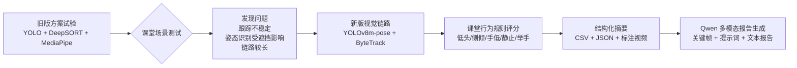

图 2-4 关键技术路线演进图

首先，在项目早期，团队曾尝试采用旧版实现路径，即以目标检测、DeepSORT 跟踪和 MediaPipe 姿态分析相结合的方式完成课堂行为识别。这一路线的基本思路是：先利用检测模型获得画面中的学生目标框，再通过 DeepSORT 对目标进行跨帧跟踪，最后对裁剪出的单个学生区域调用 MediaPipe 姿态模块，以提取关键人体部位信息并据此判断是否存在低头、偏斜等行为。从技术逻辑上看，这一方案具备一定合理性，因为它将“检测、跟踪、姿态分析”拆分为相对独立的三个步骤，便于逐步调试和功能验证；同时，MediaPipe 在轻量级姿态估计方面具有一定优势，因此适合作为原型阶段的快速试验工具。

然而，在实际课堂视频场景中，这一路线逐渐暴露出若干不足。首先，课堂视频中学生数量较多、姿态变化频繁、遮挡情况复杂，DeepSORT 在跨帧关联时容易出现身份漂移或目标切换，进而影响后续基于学生个体的时间统计。其次，MediaPipe 更适用于单人或相对清晰的人体姿态估计场景，而在教室这种远距离、多目标、局部遮挡明显的环境中，其关键点稳定性和有效识别率相对有限。再次，旧版路径需要先检测、再裁剪、再单独做姿态分析，处理链路较长，模块之间的耦合关系较强，不仅增加了计算和调试开销，也使整体工程结构较为复杂。正是由于上述问题，团队在功能验证完成后判断该方案难以支撑一个更加稳定、清晰、可扩展的课堂分析系统，因此决定更换主技术路线。

在新版实现方案中，系统将核心视觉链路统一为 `YOLOv8m-pose + ByteTrack`。其中，`YOLOv8m-pose` 直接承担人体检测与姿态关键点识别两项任务，能够在同一次模型推理中同步输出学生的人体边界框和关键点坐标，从而减少传统多阶段处理链路中的中间转换和信息损失。与旧版方案相比，这种“检测与姿态一体化”的设计使系统结构更加紧凑，也更适合课堂视频的批量逐帧处理。项目当前主流程中所使用的模型文件为 `yolov8m-pose.pt`，它能够为后续的低头检测、手部位置判断和姿态倾斜分析提供较直接的数据基础。

在目标关联方面，系统采用 `ByteTrack` 作为新版主流程中的跟踪算法。其主要作用在于对连续视频帧中的学生目标进行身份关联，为每一位学生分配稳定的 `track_id`。在课堂专注度分析任务中，目标跟踪并不仅仅是为了显示编号，更关键的是要在时间维度上持续积累同一学生的行为状态。因为专注状态通常不是单帧瞬时属性，而是与行为持续时长密切相关。只有在跨帧身份保持相对稳定的前提下，系统才能进一步统计某位学生低头多长时间、是否长时间静止、某一事件是否构成持续性行为。因此，`ByteTrack` 的引入不仅增强了视觉主链路的稳定性，也为系统后续的规则评分和时序行为分析奠定了基础。

图 2-5 展示了新版视觉主链路的基本结构。该链路以视频帧为处理单位，在同一流程中完成检测、姿态关键点提取和跨帧身份关联，并将结果传递给后续行为分析模块。

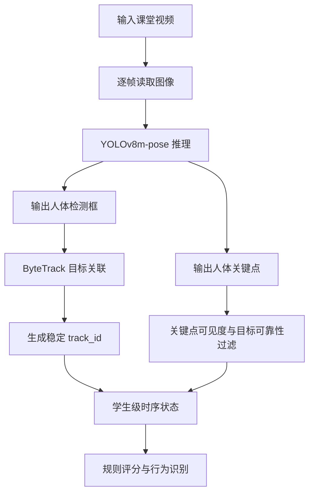

图 2-5 YOLOv8m-pose 与 ByteTrack 主链路图

在完成新版检测与跟踪链路重构后，项目进一步围绕课堂场景构建了“YOLO + ByteTrack + 规则评分”的核心分析机制。之所以采用规则评分设计，而不是直接训练一个端到端行为分类模型，主要原因在于课堂专注度本身具有较强的语义解释性和场景依赖性。对于课程设计项目而言，规则化方案不仅更易落地，而且更便于说明判定依据和系统工作原理。当前系统将学生在课堂中的行为状态划分为短时姿态异常和长时持续行为两个层次，并在此基础上形成可量化的专注度评分与事件判定逻辑。

在短时规则层面，系统主要利用关键点之间的几何关系判断学生是否存在典型的疑似分心姿态。例如，系统通过比较鼻尖与双肩中心的相对位置判断学生是否存在明显低头行为；通过分析双肩连线的倾角估计学生是否存在身体偏斜、歪斜或明显前倾状态；通过比较手腕与髋部的相对位置，判断学生是否存在手部位置过低、姿态松散等现象。这些规则本质上都是基于人体关键点关系的几何判定，具有较强的直观性。为了提高可靠性，系统在正式计算之前还会对目标进行过滤，例如剔除边界框高度过小、过于靠近图像边缘或关键点可见度过低的目标，以减少远距离小目标和局部遮挡带来的误判。

在长时行为层面，系统引入了时序状态维护机制，通过 `StudentStateTracker` 为每一位学生维护若干历史状态序列和计时器，包括头部位置、眼部可见状态、短时低头计时、长时低头计时、静止计时以及举手计时等。借助这些状态信息，系统可以将课堂行为从“瞬时姿态”提升为“持续状态”进行理解。例如，若学生仅在某一两帧中出现头部轻微下沉，则不应直接被判定为严重不专注；而当这一状态持续达到设定阈值时，系统才会将其升级为长时间低头行为。类似地，长时间静止、疑似闭眼等行为也必须依赖时间维度上的累积判断才能更贴近真实课堂语境。相比单帧分类，这种规则评分与时序状态结合的方式更具有解释力，也更能降低误报率。

在最终的课堂专注度判定中，系统采用“基础分值 + 规则扣分 + 时序升级”的综合策略。通常情况下，每名学生在初始状态下拥有较高的专注度分值，而当检测到低头、侧倾、手部过低等行为时，系统会按规则进行扣分；若某些行为持续时间进一步增长，则会触发更高优先级的长时行为标记，例如长时间低头、闭眼或静止。系统在此基础上再结合阈值判断当前状态是否属于不专注事件。需要特别指出的是，系统对“举手”行为进行了单独建模和优先级处理，因为课堂中的持续举手通常意味着互动参与，而不是注意力下降。因此，当系统在同一时间段内识别到持续举手行为时，会优先将其解释为课堂互动信号，而非不专注行为。这样的设计体现出项目不仅关注检测结果本身，也关注课堂语义下不同行为的实际含义。

图 2-6 对规则评分机制进行了概括。系统不是简单根据某一帧直接给出最终结论，而是将短时规则、长时状态和举手互动规则共同纳入判断过程，从而得到更符合课堂语义的行为结果。

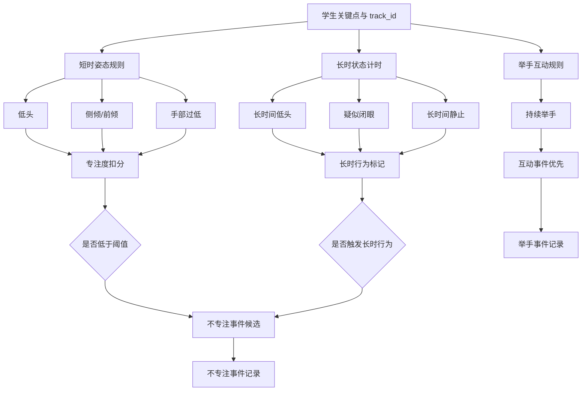

图 2-6 专注度规则评分与行为判定机制图

在完成结构化视觉分析之后，项目进一步接入了 Qwen 多模态大模型，以增强分析结果的语言表达能力。传统课堂行为分析系统通常只能输出表格、视频或简单统计信息，这虽然能够满足基本记录需求，但在课程汇报、方案展示和教学复盘场景下，往往仍需要人工根据结果撰写说明文字。为解决这一问题，系统在现有检测结果的基础上，增加了“结构化摘要 + 关键帧 + 提示词模板 + Qwen 报告生成”的后处理链路。

具体而言，系统首先根据 `attention_report.csv` 和 `attention_summary.json` 中的信息，对不专注事件进行学生级和时间段级聚合，并从中筛选具有代表性的关键事件。随后，系统根据事件的中点帧或高优先级帧位置，从原始视频中抽取关键帧图像，并将这些图像与视频元信息、统计摘要、重点学生信息以及部分 CSV 样例记录一起注入到提示词模板中。最终，系统通过 DashScope 兼容接口调用 Qwen 多模态模型，默认使用 `qwen3.6-plus`，将文本与图像共同作为输入，生成课堂行为分析报告。Qwen 的引入并不改变前端视觉分析流程的核心判定逻辑，而是作为后处理层对现有分析结果进行语言整合与总结表达，使系统能够从“输出检测结果”进一步发展为“输出可阅读、可解释、可展示的综合分析报告”。

图 2-7 展示了 Qwen 报告生成流程。该流程以视觉分析结果为基础，将结构化统计和关键帧图像共同作为大模型输入，使最终报告既包含数据依据，也具备图像证据支撑。

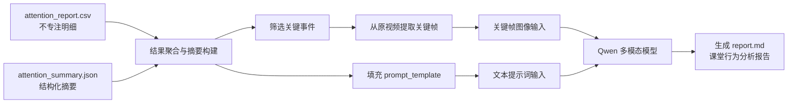

图 2-7 Qwen 多模态报告生成流程图

从整体上看，项目在关键技术层面的核心价值体现在三个方面。第一，通过对旧版 `DeepSORT + MediaPipe` 路线的实际试验和问题总结，团队明确了课堂场景对检测稳定性和工程结构的特殊要求，并据此完成了技术路线升级。第二，通过 `YOLOv8m-pose + ByteTrack + 规则评分` 的组合，系统在保证工程可行性的同时，构建了一个具有较强可解释性的课堂专注度分析主链路。第三，通过接入 Qwen 多模态大模型，系统进一步提升了结果表达能力，使项目成果不仅能够被“计算出来”，还能够被“说明出来”。这三部分共同构成了本项目当前版本的关键技术基础。

### 2.4 作品特色

本作品的特色首先体现在问题导向的明确性上。系统不是一个面向一般人体姿态识别的通用演示程序，而是明确面向课堂教学这一特定应用场景，围绕“学生是否专注”“课堂中是否存在较明显的不良听课姿态”“课堂互动行为是否活跃”“哪些片段值得教师重点复核”等问题展开设计。由于应用目标十分具体，系统在技术选型、规则设计和结果组织方式上都更强调课堂语境中的实际意义，而不仅仅追求抽象的检测效果。这种从场景需求出发反向推动系统设计的方式，使项目具有较强的现实针对性。

其次，本作品在方法设计上兼顾了工程可行性、可解释性与可迭代性。项目并未单纯依赖复杂模型堆叠，而是在稳定视觉模型基础上，将姿态估计、目标跟踪、规则评分和时序状态维护结合起来，形成了一个逻辑清晰的课堂行为分析框架。对于课程设计和工程原型而言，这种方案具有明显优势：一方面，它不依赖大规模行为标注数据即可完成系统构建；另一方面，其判定依据可以清晰追溯到“关键点位置关系”“行为持续时间”“阈值条件”等具体规则，因此在说明书、答辩和后续调参过程中都具有较高的可解释性。更重要的是，规则化设计便于后续扩展新的行为类型，例如转头、趴桌、交谈等，从而为系统持续完善提供了较好的技术基础。

再次，本作品形成了从视频分析到结果表达的完整闭环。传统课程项目往往停留在检测结果输出阶段，而本系统在完成学生行为识别之后，还能够进一步生成结构化摘要、抽取关键帧，并借助 Qwen 多模态大模型自动形成课堂分析文本。这使系统不再只是“会识别”的工具，而逐步发展为“会分析、会总结、会表达”的应用原型。对于教学展示、课程答辩和项目汇报而言，这种从数据到文本的闭环能力明显增强了成果的完整性和呈现质量，也降低了使用者对结果进行二次整理的成本。

从实用性角度来看，本项目的价值同样较为突出。首先，系统能够直接处理真实课堂视频，并输出学生级和事件级分析结果，因此具有一定的课后复盘辅助价值。教师或研究者可以借助结构化结果快速定位哪些学生在何时出现持续低头、姿态异常或缺乏互动等情况，从而提高观察效率。其次，系统支持标注视频输出和关键帧提取，这意味着分析结果不仅体现在统计表中，也能够通过可视化证据进行复核，这对于教学管理和人工确认具有现实意义。再次，系统的运行方式较为轻量，不依赖复杂服务器和数据库，既可以通过命令行执行，也可以通过本地 Web 页面操作，这使其更适合在课程实验室、教学展示环境和小规模场景中快速部署和使用。

此外，本作品还体现出较好的可迁移实用性。虽然系统当前聚焦于课堂专注度分析，但其核心框架实际上具备推广到会议行为观察、培训场景参与度分析、讲座听众状态识别等相似场景的潜力。究其原因，在于系统底层采用的是“多目标检测与跟踪 + 行为规则建模 + 摘要报告生成”的通用思路，只需根据具体场景调整规则和提示词模板，即可扩展到其他需要群体行为观察与总结表达的任务。因此，本项目不仅具有当前课堂场景下的直接应用价值，也具有一定的延展空间。

最后，本作品在课程设计语境下还具有较强的综合训练意义。它不是单一算法验证项目，而是将模型调用、规则设计、数据组织、系统开发、交互实现和大模型接入等多个环节整合到统一工程之中，体现了较完整的人工智能应用开发流程。从这个意义上说，项目的特色不仅在于“做出了一个可以运行的系统”，更在于围绕真实问题完成了一条从技术验证到工程实现、再到成果表达的完整实践路径。这也是本项目兼具技术特色和实际价值的重要原因。

## 3 详细设计说明

### 3.1 系统结构设计

#### 3.1.1 技术架构

本系统采用分层式技术架构，可以概括为“交互入口层—流程编排层—检测分析层—摘要报告层—配置管理层”五个层次。交互入口层包括命令行脚本 `ca_gpu.py`、报告生成入口 `llm_reporter.py` 和本地 Web 工作台 `webapp.py`，主要负责接收用户输入、组织参数并触发后续流程。流程编排层由 `classroom_attention/pipeline.py` 实现，其主要作用是统一调用检测管线和报告管线，并负责结果文件的落盘与状态回传。

系统的核心计算能力集中在检测分析层，该层主要由 `detector.py`、`scoring.py` 和 `tracker.py` 构成。其中，`detector.py` 负责视频逐帧读取、模型推理、目标跟踪、可视化标注与记录保存，是整个系统的执行主干；`scoring.py` 负责对当前帧中单个学生的姿态进行评分，并根据阈值与规则给出触发原因；`tracker.py` 中的 `StudentStateTracker` 则维护每一位学生在时间维度上的状态信息，用于支撑长时间低头、闭眼、静止和举手等行为的判定。摘要报告层位于核心分析流程之后，主要由 `reporting_summary.py` 和 `reporting_llm.py` 等模块组成，用于将离散检测结果整合为事件摘要，并进一步转化为文本报告。

这种架构的优势在于职责划分清晰、模块边界明确。视觉推理、行为判定、结果组织和交互展示分别处于不同层次，既降低了代码耦合度，也为后续替换模型、扩展规则或调整界面提供了便利。与此同时，该结构也使系统主流程能够同时服务于命令行与 Web 两种使用方式，从而减少重复开发工作量。

#### 3.1.2 功能模块设计

本系统采用面向对象与模块化相结合的设计方式进行开发。系统并不是将所有功能集中在一个脚本中顺序执行，而是按照功能职责、数据流向和处理阶段进行拆分，使视频输入、参数配置、检测跟踪、行为评分、结果汇总、报告生成和 Web 交互等功能分别由相对独立的模块承担。这样的划分方式既符合单一职责原则，也有利于后续维护、调试和功能扩展。

从系统功能层次来看，当前系统可以划分为五个主要层次。第一层是交互入口层，负责接收用户输入并触发任务执行，主要包括命令行入口 `ca_gpu.py`、报告生成入口 `llm_reporter.py` 和 Web 工作台 `webapp.py`。第二层是配置与流程编排层，主要由 `cli.py`、`config.py` 和 `pipeline.py` 构成，用于完成参数解析、运行配置生成和主流程调度。第三层是核心检测分析层，主要由 `detector.py`、`scoring.py` 和 `tracker.py` 构成，是系统实现课堂行为识别的核心部分。第四层是结果汇总与报告生成层，主要包括 `reporting_summary.py`、`reporting_llm.py` 和 `reporting.py`，用于完成检测结果聚合、结构化摘要构建、关键帧提取和大模型报告生成。第五层是数据与资源层，包括输入视频、模型权重文件、跟踪配置文件、提示词模板以及各类输出结果文件。

图 3-2 给出了系统开发的功能模块结构图。该图从层次结构上展示了系统由哪些部分组成，以及各层之间的基本关系。

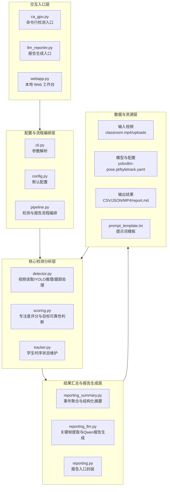

图 3-2 系统功能模块结构图

从模块划分原则来看，系统主要依据三个方面进行设计。首先，按照用户交互方式进行入口划分，使命令行检测、独立报告生成和 Web 页面操作互不混杂，便于不同使用场景下调用同一套核心能力。其次，按照视频分析处理流程进行功能划分，将参数配置、模型推理、目标跟踪、行为评分、时序状态维护、结果聚合和报告生成拆分为独立模块，使每个模块只承担相对明确的职责。最后，按照数据流向进行层次划分，使输入视频、模型配置、过程记录、结构化摘要和最终报告之间形成较清晰的流转关系，从而降低模块耦合度，提高系统可维护性。

由于本项目主要采用 Python 模块和类进行组织，其模块调用关系更接近面向对象设计中的包图。图 3-3 展示了系统主要模块之间的调用关系。可以看出，`ca_gpu.py` 和 `webapp.py` 并不直接承担复杂的检测逻辑，而是通过 `pipeline.py` 调用核心分析模块；`detector.py` 作为检测主类所在模块，会在逐帧处理过程中调用 `scoring.py` 和 `tracker.py`；检测结束后，结果交由 `reporting_summary.py` 进行聚合；若需要生成自然语言报告，则继续调用 `reporting_llm.py` 完成关键帧抽取和 Qwen 接口请求。

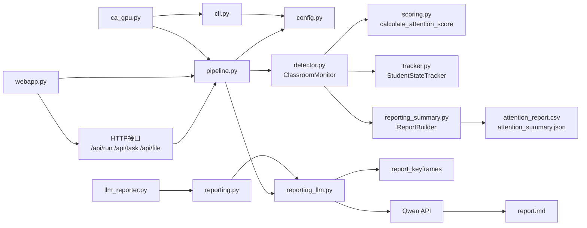

图 3-3 系统主要模块调用关系图

各模块的职责可以进一步说明如下。`ca_gpu.py` 是检测流程的命令行入口，主要用于从终端启动课堂视频分析；`llm_reporter.py` 是大模型报告生成入口，适合在已有检测结果基础上单独生成报告；`webapp.py` 是本地 Web 工作台，负责视频上传、参数校验、异步任务创建、日志轮询和结果文件下载。`cli.py` 负责定义命令行参数并将其转换为系统配置，`config.py` 负责保存默认阈值、模型路径、跟踪配置和输出参数，`pipeline.py` 则承担统一调度职责，是连接入口层和核心功能层的关键模块。

在核心检测分析层中，`detector.py` 是系统主处理模块，它负责打开视频、读取帧、调用 YOLO 姿态模型、解析检测结果、执行 ByteTrack 跟踪、绘制标注视频并保存不专注记录。`scoring.py` 主要负责基于关键点几何关系计算专注度得分，并判断目标是否具备足够可靠的姿态信息。`tracker.py` 则通过 `StudentStateTracker` 类维护学生级时序状态，包括低头持续时间、静止持续时间、闭眼状态和举手持续时间等，为长时行为识别提供支持。检测流程结束后，`reporting_summary.py` 中的 `ReportBuilder` 会将逐帧记录聚合为学生级和事件级摘要，并生成后续报告所需的结构化数据。若启用智能报告功能，`reporting_llm.py` 会读取摘要文件和明细文件，从原视频中抽取关键帧，构造提示词并调用 Qwen 多模态接口，最终生成 Markdown 格式的课堂分析报告。

整体来看，系统按照“入口解耦、流程统一、核心独立、结果后处理”的原则进行模块划分。入口层只负责用户交互和任务触发，流程层负责调度，核心层负责视觉分析与行为识别，报告层负责摘要和文本生成，数据层负责输入输出资源管理。这样的结构既符合当前项目的功能需求，也为后续扩展更多行为规则、替换检测模型、接入数据库或升级 Web 界面提供了较好的工程基础。
#### 3.1.3 关键功能/算法设计

本系统的关键功能主要包括视频检测与跟踪、专注度评分与行为判定、事件聚合与结构化摘要生成、关键帧抽取与大模型报告生成四个部分。上述功能并非彼此孤立，而是按照视频数据流逐步展开：系统先从原始课堂视频中提取学生目标与姿态关键点，再基于跟踪编号维护学生个体的时序状态，随后根据规则判定不专注行为与举手行为，最后将离散记录聚合为可阅读、可复核、可生成报告的结果数据。由于本项目未使用数据库系统，因此本节不涉及存储过程设计，重点说明核心算法流程及功能优化方法。

图 3-4 给出了系统关键功能的总体实现流程。从图中可以看出，系统首先完成视频读取和参数初始化，然后进入逐帧分析循环。每一帧经过模型推理、目标跟踪、可靠性过滤和行为评分后，系统会保存符合条件的事件记录；当全部视频帧处理完成后，系统再执行事件合并、结构化摘要导出、关键帧抽取和报告生成等后处理操作。

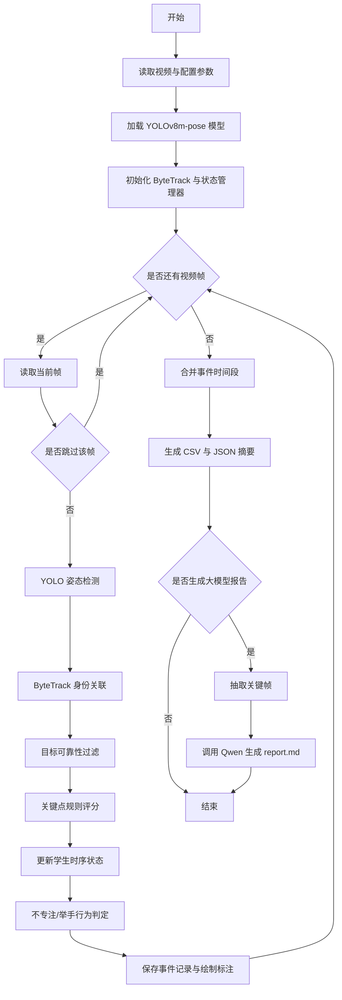

图 3-4 系统关键功能总体实现流程图

在视频检测与跟踪阶段，系统以课堂视频帧为基本处理单位。为了兼顾处理效率和分析效果，系统支持跳帧策略，即每隔若干帧进行一次实际推理，从而在不显著影响行为片段识别的前提下降低计算开销。对于需要保存标注视频的任务，系统还会根据实际处理帧率创建视频写出对象，将检测框、学生编号、专注状态和主要行为原因绘制到输出视频中。模型推理阶段使用 `YOLOv8m-pose`，该模型能够同时输出人体边界框与关键点坐标；跟踪阶段则通过 `ByteTrack` 为每个学生分配相对稳定的 `track_id`。在这一过程中，系统会对检测目标进行可靠性过滤，例如判断边界框高度是否过小、目标是否过于靠近画面边缘、可见关键点数量是否低于阈值等。该过滤步骤是减少误判的重要前置条件，能够避免远距离小目标、半身目标或遮挡严重目标进入后续评分过程。

图 3-5 展示了视频检测与目标可靠性过滤的算法流程。该流程体现了系统在模型推理之后并不立即进行行为判断，而是先对目标质量进行筛选，以保证后续规则评分具有较可靠的数据基础。

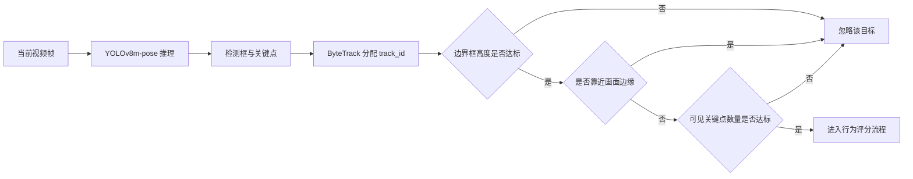

图 3-5 视频检测与目标可靠性过滤流程图

在专注度评分算法中，系统采用“基础分值—规则扣分—时序修正”的设计思想。每一名学生在单帧分析开始时拥有一个初始专注度分值，系统随后根据关键点之间的几何关系判断是否存在短时异常姿态。例如，鼻尖相对于双肩中心明显下沉并持续达到一定时间，可判定为低头；双肩连线倾角过大，可判定为身体侧倾或前倾；手腕位置显著低于髋部，可判定为手部位置过低。不同规则会对专注度分值产生不同程度的影响，最终形成当前帧的行为评分与触发原因。

仅依靠单帧评分仍不足以准确描述课堂行为，因此系统进一步设计了学生时序状态维护机制。`StudentStateTracker` 会以 `track_id` 为索引，持续保存每名学生的头部位置、眼部状态、短时低头计时、长时低头计时、静止计时和举手计时等信息。当某种行为仅短暂出现时，系统不会立即将其提升为强事件；只有当该状态持续时间超过设定阈值后，才会触发长时间低头、疑似闭眼或长时间静止等长时行为标记。对于举手行为，系统通过手腕、肘部和肩部之间的相对位置关系判断手臂是否持续抬起，并将其作为课堂互动事件单独记录，而不是简单归入不专注行为。

图 3-6 展示了专注度评分与时序行为判定的核心逻辑。该流程体现了系统从关键点输入到最终事件输出的判断路径，也说明了短时规则和长时规则之间的关系。

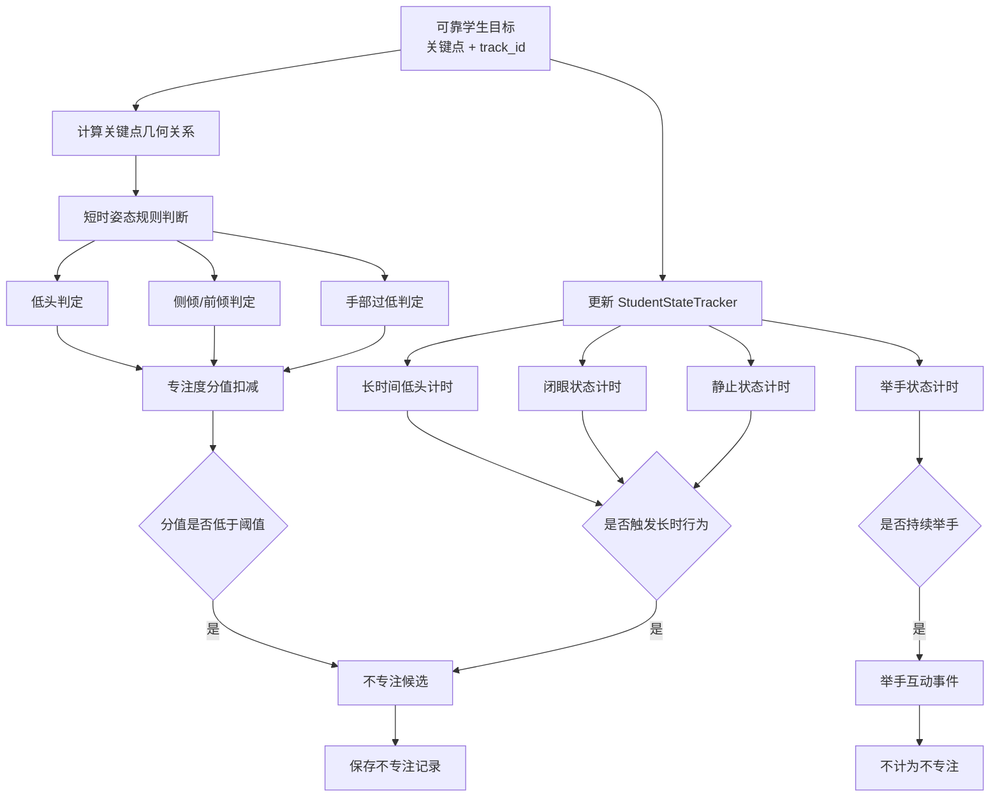

图 3-6 专注度评分与时序行为判定流程图

检测流程结束后，系统需要将逐帧产生的大量离散记录转换为具有阅读价值的事件摘要。由于同一名学生在连续时间内可能多次被记录为不专注，如果直接输出所有帧级记录，会导致结果冗余且难以阅读。因此，系统在 `ReportBuilder` 中采用事件聚合策略：首先按照学生编号对记录进行分组，再按时间顺序排序；当相邻记录之间的时间间隔小于设定阈值时，将其合并为同一事件片段；当间隔超过阈值时，则划分为新的事件。对于每个事件片段，系统计算起止时间、持续时长、主导原因、代表帧和得分等信息，并进一步形成学生级总时长、事件次数和主要原因统计。该过程使原始检测结果从“帧级记录”转化为“事件级摘要”，显著提高了结果的可读性和报告生成质量。

图 3-7 展示了事件聚合与结构化摘要生成流程。通过该流程，系统能够将 `attention_records` 转换为 `attention_report.csv` 和 `attention_summary.json`，并为后续关键帧抽取提供候选事件。

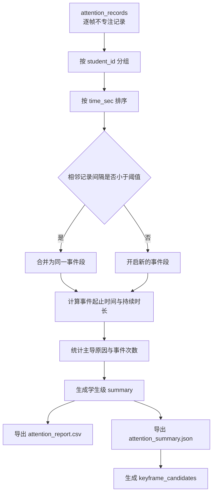

图 3-7 事件聚合与结构化摘要生成流程图

在报告生成阶段，系统以结构化摘要和明细记录为基础，结合原始视频抽取关键帧，并调用 Qwen 多模态大模型生成 Markdown 报告。关键帧抽取并不是随机截帧，而是根据结构化摘要中的关键帧候选列表进行选择。系统通常优先选择持续时间较长、目标框面积较大、得分较低或代表性较强的事件片段，以保证输入给大模型的图像具有较高分析价值。随后，系统将视频元信息、总体统计、重点学生、部分明细记录和关键帧描述填入 `prompt_template.txt`，并与关键帧图像一同提交给 Qwen 模型。模型生成的报告会被保存为 `report.md`，并在末尾附上关键帧文件索引，便于人工复核。

图 3-8 展示了大模型报告生成的算法流程。该流程说明 Qwen 报告生成并不是脱离检测结果的自由生成，而是建立在结构化数据和关键帧证据基础上的文本整合过程。

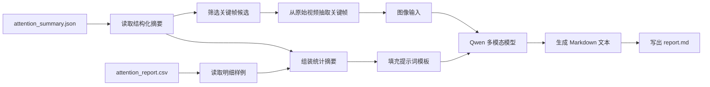

图 3-8 关键帧抽取与 Qwen 报告生成流程图

在功能优化方面，系统主要采用了以下几类技巧。第一，在性能优化上，系统支持跳帧处理、GPU 推理和半精度推理选项，使长视频处理能够在可接受时间内完成；同时，标注视频输出采用按需开启方式，避免在只需要数据结果时产生额外写盘开销。第二，在误判控制上，系统增加了目标可靠性过滤，通过最小边界框高度、边缘框排除、关键点可见度阈值和最少可见关键点数量等条件，减少远距离、遮挡和局部目标带来的误检。第三，在行为稳定性上，系统使用时序计时器而不是单帧判断来识别长时间行为，从而降低瞬时姿态波动导致的误报。第四，在结果可读性上，系统对连续帧记录进行事件合并，只保留达到最小时长要求的片段，并统计主导原因，使输出结果更适合人工阅读和大模型摘要。第五，在报告质量上，系统通过关键帧候选优先级筛选机制选择更具代表性的图像输入 Qwen 模型，从而提高报告内容与实际课堂画面的对应程度。

综上，系统的关键算法设计体现出“模型推理提供感知基础、规则评分提供解释逻辑、时序状态提高稳定性、事件聚合增强可读性、大模型生成提升表达能力”的总体思路。该设计既适应课堂视频中多目标、远距离、遮挡较多的实际特点，也兼顾了课程设计项目对可实现性、可说明性和展示效果的要求。
### 3.2 数据结构设计

本系统的数据组织方式以文件存储和内存结构维护为主，而非传统数据库管理模式。因此，其数据结构设计重点不在关系表或索引，而在于如何将检测记录、聚合摘要、状态缓存和前后模块间的数据载荷有效组织起来。

在持久化存储层面，系统的主要数据文件包括输入视频、逐条检测记录、结构化摘要文件、标注视频、举手事件记录以及最终生成的 Markdown 报告。其中，`attention_report.csv` 用于存储逐条不专注记录，字段通常包括学生编号、发生时间、帧号、专注度得分、触发原因和边界框信息；`attention_summary.json` 则在 CSV 明细基础上进一步组织视频元信息、整体统计、学生级汇总、关键帧候选和举手事件等内容，构成系统后处理阶段的主要结构化数据来源；`raise_hand_events.csv` 专门记录检测到的举手行为；`output_annotated.mp4` 负责保存带有边界框和标签的分析视频；`report_keyframes` 目录中则保存从关键事件对应时间点截取出的代表性图像；`report.md` 最终保存由大模型生成的课堂行为分析报告。可以看出，系统虽然没有数据库，但通过清晰的文件命名和内容分工，仍然建立了较完整的数据流转结构。

在模块接口层面，系统主要通过 Python 字典、配置对象和命名空间参数传递信息。检测流程接口 `run_detection_pipeline` 以类似 `argparse.Namespace` 的参数对象作为输入，并返回包含 CSV 路径、JSON 路径、视频路径、举手记录路径以及摘要结果的数据字典；报告流程接口 `run_llm_report_pipeline` 则接收摘要文件路径、CSV 路径、视频路径、模型名称和密钥文件等参数，并返回关键帧目录和报告输出路径。Web 工作台与后端之间的通信采用 JSON 载荷形式，前端将视频路径、阈值、跳帧数、输出选项和报告参数等打包为任务请求，后端在任务执行后再以 JSON 形式回传当前状态、日志信息和结果文件路径。

在内存结构方面，系统最关键的对象包括配置类 `Config`、逐条记录列表 `attention_records`、时序状态管理器 `StudentStateTracker` 以及聚合摘要 `summary`。其中，`Config` 作为全局配置容器，统一保存模型路径、阈值、持续时长、视频输出开关和最小事件条件等参数；`attention_records` 是检测过程中不断增长的列表，每个元素都是一个字典，记录某名学生在某一帧被判定为不专注时的详细信息；`StudentStateTracker` 内部利用 `defaultdict` 和 `deque` 维护每位学生的历史状态与计时器，是长时行为识别的重要数据支撑；而 `summary` 则在检测结束后对学生级事件进行聚合，成为结构化摘要和报告生成的核心依据。总体而言，这些数据结构共同支撑了系统从流式视频处理到静态结果输出的全过程。

### 3.3 系统界面设计

#### 3.3.1 界面设计风格

系统提供的本地 Web 工作台采用单页面布局形式，整体风格偏向正式、简洁和可操作性导向。页面以浅色背景和卡片式区域划分为主要视觉结构，既保证了课堂演示时的清晰度，也兼顾了参数配置和结果查看的便利性。页面顶部主要承担系统名称、功能简介和整体说明的展示任务，中部则以左右分栏方式分别承载参数配置和运行结果，底部区域则重点呈现日志与报告内容。

从设计思路来看，该界面并不追求复杂的前端交互效果，而是强调分析任务从输入到输出的完整闭环。用户进入页面后，可以快速理解系统的用途和使用流程，在较少学习成本下完成视频选择、参数设定、任务提交和结果查看。因此，界面设计服务于系统的工程实用性和项目展示性，而不是单纯追求视觉装饰。

#### 3.3.2 主要功能页面

由于系统采用单页式 Web 工作台设计，因此其主要功能区域都集中在同一页面中。首先是视频输入区域，用户可以直接选择本地视频文件上传，也可以从已有的 `uploads` 目录中选取历史视频作为输入。其次是参数配置区域，页面为用户提供了专注度阈值、跳帧数、最大处理帧数、设备编号、标注视频输出、标签显示与否、报告是否生成等选项，便于针对不同视频质量和分析需求进行调整。

任务启动后，页面会进入运行状态，并通过轮询方式持续获取任务日志和执行进度。系统会在结果区域动态展示 CSV、JSON、标注视频、举手事件表格、关键帧目录和 Markdown 报告等输出文件，并提供下载或打开链接。若报告已经生成，页面还会将报告内容直接渲染到预览区中，使用户无需另行打开文件即可浏览分析结论。这种将输入、运行、结果和报告集成于单页的方式，有利于增强系统的交互流畅性，也便于课堂演示和答辩展示。

#### 3.3.3 Web 网站页面结构设计

从页面结构角度看，系统 Web 端实际上围绕一个主页面展开，其内部按照功能逻辑划分为输入区、配置区、状态区、结果区和预览区五个部分。用户首先在输入区中完成视频选择，然后在配置区中确定各项分析参数；任务提交后，状态区负责反馈运行状态与日志信息；结果区则在任务完成后集中展示各种输出文件；报告预览区最后承担对 Markdown 文本的即时展示作用。页面间不存在复杂的跳转关系，也无需多页面导航，这种设计有利于减少使用成本，并保持课堂分析流程的连续性。

## 4 系统安装及使用说明

本系统的安装过程较为直接。用户首先需要准备 Python 3.9 及以上版本的运行环境，并在项目根目录执行 `pip install -r requirements.txt` 安装相关依赖。完成依赖安装后，需要确认项目目录中已经包含姿态估计模型文件 `yolov8m-pose.pt`、跟踪配置文件 `trackers/bytetrack.yaml`、提示词模板 `prompt_template.txt` 以及用于访问大模型接口的密钥文件 `qwen_api_key.txt`，或者已在环境变量中正确配置 `DASHSCOPE_API_KEY`。

在命令行模式下，用户可以直接执行 `python ca_gpu.py classroom.mp4 --save-video --export-json --json-output attention_summary.json` 启动检测流程。系统运行结束后，通常会生成 `attention_report.csv`、`attention_summary.json`、`output_annotated.mp4` 和在特定条件下生成的 `raise_hand_events.csv` 等文件。如果已经具备摘要文件和明细文件，用户还可以通过 `python llm_reporter.py --summary attention_summary.json --csv attention_report.csv --video classroom.mp4 --output report.md` 单独执行报告生成流程。

若希望以图形界面的方式使用系统，则可以运行 `python webapp.py` 启动本地 Web 工作台，并在浏览器中访问 `http://127.0.0.1:6006`。进入页面后，用户只需上传视频或选择已有视频，设置相应参数并提交任务，即可等待系统自动完成分析与报告生成。需要注意的是，若运行环境中没有可用 GPU，则应根据需要切换至 CPU 模式；若课堂画面较远或目标较小，可适当提高输入图像尺寸、降低检测置信度，以改善检测效果；若希望启用发呆或长时间静止相关规则，则应显式开启对应参数。旧版 `ca.py` 虽然仍可查看，但其技术路线已经不再代表当前系统主流程，因此在说明和使用时应以新的模块化实现方案为准。

## 5 总结

本项目围绕课堂教学场景下学生专注状态难以持续观察、难以量化记录、难以自动汇总的问题，设计并实现了一套基于计算机视觉、规则评分和多模态大模型的课堂专注度分析系统。系统以课堂视频作为输入，以 `YOLOv8m-pose` 姿态估计模型和 `ByteTrack` 多目标跟踪算法为视觉分析基础，通过关键点几何关系和学生时序状态累积机制，识别课堂中的低头、侧倾、手部过低、长时间低头、静止、闭眼以及举手互动等行为，并能够输出不专注明细记录、结构化摘要、标注视频、举手事件表和 Markdown 分析报告。整体来看，系统已经形成了较完整的“视频输入—目标检测—身份跟踪—行为判定—事件聚合—报告生成”工作流，能够较好地体现课堂智能分析系统的基本功能形态。

在作品创意方面，本项目从课堂教学管理和教学复盘的实际需求出发，将学生专注度这一较为抽象的课堂状态转化为可观察、可记录、可统计的姿态和行为事件。相较于单纯的人体检测或姿态识别程序，本项目更关注行为结果在课堂语境中的解释意义，例如将持续低头、长时间静止等行为视为不专注风险信号，而将持续举手行为作为课堂互动信号单独记录。这样的设计使系统不只是完成视觉识别任务，而且能够围绕教学场景形成较明确的分析目标。

在开发实现方面，项目经历了从旧版方案验证到新版主链路重构的过程。早期采用 `DeepSORT + MediaPipe` 的路线完成了初步实验，但在课堂视频中暴露出目标跟踪不稳定、姿态识别受遮挡和远距离影响较大、处理链路较长等问题。随后，系统将主流程调整为 `YOLOv8m-pose + ByteTrack + 规则评分` 的方案，使人体检测、关键点识别和身份跟踪更加统一，工程结构也更加清晰。通过进一步引入 `StudentStateTracker` 进行时序状态维护，系统能够从单帧姿态判断扩展到持续行为识别，从而提升了结果的合理性和可解释性。

在结果表达方面，系统不仅输出 CSV、JSON 和标注视频等传统结构化结果，还进一步接入 Qwen 多模态大模型，通过关键帧提取和提示词模板组织生成课堂分析报告。这一设计使项目形成了从视觉分析到自然语言总结的完整闭环，降低了用户对检测结果进行二次整理和人工撰写报告的成本，也增强了项目在课程答辩、教学展示和课后复盘场景中的可读性与呈现效果。

从团队开发过程来看，本项目的完成不仅涉及模型调用，还涉及视频处理、目标跟踪、规则算法、数据结构、Web 交互、文件输出和大模型接口调用等多个环节。通过该项目，团队对人工智能应用系统的完整开发流程有了更加系统的认识，也进一步理解了工程实现中“算法效果、运行效率、结果可解释性和用户使用体验”之间需要综合平衡。尤其是在旧方案效果不理想后，团队能够根据实际问题调整技术路线，这一过程体现了项目开发中的问题分析能力和方案迭代能力。

当然，当前系统仍然存在一定不足。首先，系统主要依赖人体关键点和规则评分进行行为判断，对于复杂课堂行为的理解仍然较为有限，例如转头交谈、趴桌、看书写字与低头分心之间的区别仍需要进一步细化。其次，课堂视频中常见的遮挡、远距离小目标、光照变化和拍摄角度差异仍会影响检测结果的稳定性。再次，系统当前主要面向单视频离线分析，尚未形成支持多班级、多课程、长期统计和用户权限管理的平台化能力。此外，大模型报告生成依赖外部 API 和网络环境，在实际部署中需要考虑密钥管理、调用成本和数据隐私等问题。

后续改进可以从以下几个方向展开。第一，可以引入更丰富的课堂行为类别和更精细的规则体系，增强系统对学习状态的区分能力。第二，可以结合更强的人脸、视线或动作识别模型，提高闭眼、走神、转头和交谈等行为识别的准确率。第三，可以建立数据库和用户管理模块，将单次视频分析扩展为长期课堂数据管理平台。第四，可以进一步优化 Web 工作台界面，增加任务历史、结果对比、图表统计和报告模板配置等功能。第五，可以从隐私保护和教育伦理角度完善系统使用规范，确保课堂视频分析结果仅作为教学辅助参考，而不是对学生状态进行简单绝对化评价。

总体而言，本项目已经完成了一个功能较完整、结构较清晰、具有一定实用价值和展示价值的课堂专注度分析系统原型。系统在技术上融合了姿态估计、多目标跟踪、规则评分、结构化摘要和大模型文本生成等能力，在应用上面向课堂教学复盘与学生状态分析需求，具有较好的课程设计意义和后续扩展空间。

## 6 附录

### 6.1 名词定义

| 名词 | 定义 |
|---|---|
| 课堂专注度 | 本项目中指学生在课堂中保持听讲、观察或参与互动的状态。系统通过姿态变化和行为持续时间对其进行近似分析。 |
| YOLO | You Only Look Once 的缩写，是一种典型的实时目标检测模型系列。本项目使用其姿态估计版本完成学生检测和关键点识别。 |
| YOLOv8m-pose | Ultralytics 提供的中等规模姿态估计模型，能够同时输出人体边界框和人体关键点信息。 |
| ByteTrack | 一种多目标跟踪算法，用于在连续视频帧之间维持同一目标的身份一致性。本项目利用它为学生分配稳定的 `track_id`。 |
| DeepSORT | 一种经典多目标跟踪算法，项目早期曾用于学生身份跟踪实验，但在当前主流程中已被 ByteTrack 替代。 |
| MediaPipe | Google 提供的多媒体机器学习工具包，项目早期曾使用其姿态估计能力进行原型验证。 |
| 姿态关键点 | 表示人体各部位位置的点，例如鼻子、眼睛、肩膀、肘部、手腕和髋部等。系统基于这些点判断学生姿态。 |
| track_id | 多目标跟踪算法为同一学生在连续帧中分配的身份编号，用于跨帧统计同一学生的行为变化。 |
| 专注度评分 | 系统根据关键点几何关系和时序规则计算得到的行为评分，分值越低表示越可能存在不专注行为。 |
| 时序状态 | 系统为每名学生维护的跨帧历史信息，例如低头持续时间、静止持续时间和举手持续时间等。 |
| 关键帧 | 从代表性行为事件中抽取的视频画面，用于人工复核和大模型报告生成。 |
| Qwen | 阿里云通义千问系列大模型。本项目使用其多模态能力，将结构化数据和关键帧图像转化为课堂分析报告。 |
| DashScope | 阿里云提供的大模型服务平台，本项目通过其兼容接口调用 Qwen 模型。 |
| Markdown | 一种轻量级文本标记语言，本项目生成的 `report.md` 即为 Markdown 格式报告。 |

### 6.2 参考资料

[1] Ultralytics. Ultralytics YOLO Documentation. https://docs.ultralytics.com/  
[2] Zhang Y., Sun P., Jiang Y., et al. ByteTrack: Multi-Object Tracking by Associating Every Detection Box. ECCV, 2022.  
[3] Wojke N., Bewley A., Paulus D. Simple Online and Realtime Tracking with a Deep Association Metric. IEEE International Conference on Image Processing, 2017.  
[4] Lugaresi C., Tang J., Nash H., et al. MediaPipe: A Framework for Building Perception Pipelines. arXiv:1906.08172, 2019.  
[5] PyTorch Team. PyTorch Documentation. https://pytorch.org/docs/  
[6] OpenCV Team. OpenCV Documentation. https://docs.opencv.org/  
[7] Pandas Development Team. Pandas Documentation. https://pandas.pydata.org/docs/  
[8] NumPy Developers. NumPy Documentation. https://numpy.org/doc/  
[9] 阿里云. DashScope 模型服务文档. https://help.aliyun.com/zh/dashscope/  
[10] 项目源代码与仓库内说明文件：`README.md`、`classroom_attention/` 模块、`webapp.py`、`prompt_template.txt`。

### 6.3 源代码清单

| 文件或目录 | 作用说明 |
|---|---|
| `ca_gpu.py` | 当前检测主流程的兼容入口，调用 `classroom_attention.cli.main` 启动课堂视频分析。 |
| `llm_reporter.py` | 大模型报告生成入口，用于在已有摘要和明细文件基础上生成 Markdown 报告。 |
| `webapp.py` | 本地 Web 工作台，实现视频上传、参数配置、任务运行、日志查看和结果下载功能。 |
| `ca.py` | 早期实验脚本，采用 `YOLO + DeepSORT + MediaPipe` 路线，保留用于说明技术演进过程。 |
| `classroom_attention/__init__.py` | Python 包初始化文件。 |
| `classroom_attention/cli.py` | 命令行参数解析模块，负责将用户输入参数转换为系统运行配置。 |
| `classroom_attention/config.py` | 系统配置模块，定义模型路径、阈值、持续时间、输出选项等默认参数。 |
| `classroom_attention/pipeline.py` | 流程编排模块，统一调度检测流程和报告生成流程。 |
| `classroom_attention/detector.py` | 视频检测与分析核心模块，负责 YOLO 推理、ByteTrack 跟踪、逐帧处理和标注视频输出。 |
| `classroom_attention/scoring.py` | 评分模块，负责目标可靠性过滤、关键点规则判断和专注度得分计算。 |
| `classroom_attention/tracker.py` | 时序状态模块，负责维护学生历史状态并识别长时间低头、静止、闭眼和举手等行为。 |
| `classroom_attention/reporting_summary.py` | 结果汇总模块，负责将逐帧记录聚合为学生级和事件级结构化摘要。 |
| `classroom_attention/reporting_llm.py` | 大模型报告模块，负责关键帧抽取、提示词组装、Qwen 接口调用和报告写出。 |
| `classroom_attention/reporting.py` | 报告相关入口封装模块，用于对外提供报告生成调用接口。 |
| `prompt_template.txt` | Qwen 报告生成时使用的提示词模板。 |
| `requirements.txt` | 项目依赖列表，记录运行所需第三方库。 |
| `trackers/bytetrack.yaml` | ByteTrack 跟踪算法配置文件。 |

### 6.4 资源与输出文件清单

| 文件或目录 | 作用说明 |
|---|---|
| `classroom.mp4` | 项目示例课堂视频输入文件。 |
| `yolov8m-pose.pt` | 当前主流程使用的 YOLO 姿态估计模型权重文件。 |
| `yolo11m.pt` | 早期或备用检测模型文件。 |
| `qwen_api_key.txt` | Qwen API 密钥文件，报告生成阶段使用。 |
| `uploads/` | Web 页面上传视频的保存目录。 |
| `results/attention_report.csv` | 不专注行为逐条明细结果示例。 |
| `results/attention_summary.json` | 结构化课堂分析摘要结果示例。 |
| `results/output_annotated.mp4` | 带检测框和状态标签的标注视频结果示例。 |
| `results/raise_hand_events.csv` | 举手事件记录结果示例。 |
| `results/report.md` | Qwen 生成的课堂行为分析报告示例。 |
| `report_keyframes/` | 报告生成过程中抽取的关键帧图像目录。 |

### 6.5 主要运行命令

检测课堂视频并导出标注视频和结构化摘要的常用命令如下：

```bash
python ca_gpu.py classroom.mp4 --save-video --export-json --json-output attention_summary.json
```

在已有检测结果基础上单独生成大模型报告的常用命令如下：

```bash
python llm_reporter.py --summary attention_summary.json --csv attention_report.csv --video classroom.mp4 --output report.md
```

启动本地 Web 工作台的命令如下：

```bash
python webapp.py
```

启动后可在浏览器中访问以下地址进行操作：

```text
http://127.0.0.1:6006
```
